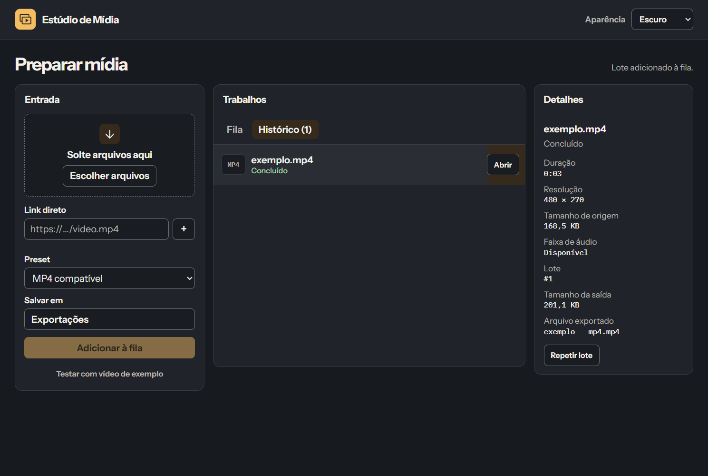

# Estúdio de Mídia

Prepare vídeo e áudio em lote no Windows. Arraste uma gravação ou cole um link direto autorizado, confira os dados do arquivo e exporte com um preset. O histórico registra a origem, a configuração e a saída de cada trabalho.



[Baixar o instalador Windows x64](https://github.com/IvensArj/Downloader/releases/tag/studio-v0.1.0) · [Ver tema claro](docs/estudio-claro.png) · [Demonstração de 26 segundos](docs/demonstracao.mp4)

## Experimente em um minuto

1. Abra o Estúdio e clique em **Testar com vídeo de exemplo**. O arquivo sintético de três segundos acompanha o pacote.
2. Confira a duração, a resolução e o tamanho em **Detalhes**. Escolha **MP4 compatível** ou **Extrair áudio em MP3**.
3. Escolha a pasta de saída e clique em **Adicionar à fila**. Em **Histórico**, clique em **Abrir**. **Repetir lote** reaplica a configuração e gera saídas com nomes disponíveis.

O aplicativo procura FFmpeg e FFprobe ao lado do executável ou no PATH. O pacote padrão distribui a interface e o núcleo, e usa o FFmpeg da sua máquina. Para MP4, use um build com `libx264` ou `h264_mf`. Para MP3, use um build com `libmp3lame`. Links diretos apontam ao arquivo de mídia. Para páginas que exigem extração, o [Baixador de Mídia](../README.md) é a opção existente.

## Executar, testar e compilar

No Windows, instale Node 24, Rust estável, as ferramentas C++ e o WebView2 conforme os [pré-requisitos do Tauri](https://v2.tauri.app/start/prerequisites/). Com FFmpeg e FFprobe disponíveis, execute os comandos abaixo na pasta `studio`.

```powershell
npm ci
npm run tauri dev
cargo test --locked -p studio-core
npm run tauri build -- --bundles nsis
```

O instalador aparece em `target/release/bundle/nsis/`. O [workflow Windows](../.github/workflows/studio.yml) disponibiliza o instalador e seu SHA-256 como artefato. Uma tag `studio-v*` publica uma pré-release do piloto.

### Medições do piloto

| Medida | Resultado |
| --- | ---: |
| Instalador NSIS Windows x64, sem FFmpeg | 3,29 MiB |
| Espaço ocupado após instalação, sem cache | 12,26 MiB |
| Mediana até a janela aparecer, três execuções | 0,10 s |
| Primeira abertura da amostra | 0,79 s |
| Mediana de memória em repouso, soma do conjunto residente do app e dos processos WebView2 | 399,8 MiB |

Medição local em Windows com WebView2 já instalado, usando um perfil de teste por execução e captura de memória após pelo menos dois segundos. A soma da memória residente pode contar páginas compartilhadas mais de uma vez. O instalador piloto é distribuído sem assinatura digital e as ferramentas de mídia são instaladas separadamente.

## Como funciona

- A interface TypeScript apresenta três áreas de trabalho, com temas Claro, Escuro e Sistema. As fontes Instrument Sans e IBM Plex Mono são locais.
- O núcleo Rust controla dois trabalhadores. A fila e o histórico ficam em `fila.sqlite3` nos dados locais do aplicativo. Trabalhos em execução encontrados após um fechamento reaparecem como **Interrompido**. **Tentar de novo** reinicia a operação com as opções salvas.
- O FFprobe inspeciona a mídia. O FFmpeg escreve em um arquivo temporário na pasta de destino. Somente uma operação bem-sucedida publica a saída com um nome disponível. O arquivo de entrada permanece no lugar.
- O núcleo é exercitado com mídia real e um servidor HTTP local. Para testar a recuperação manualmente, adicione um link direto inexistente, confira a falha no histórico e use **Tentar de novo** depois de corrigir a origem no servidor.

Para teste isolado, `MEDIA_STUDIO_DATA_DIR` e `MEDIA_STUDIO_OUTPUT_DIR` definem as pastas de dados e saída. `MEDIA_STUDIO_FFMPEG_DIR` aponta para uma pasta que contém os dois executáveis de mídia.

## Validação Android

A prova de conceito do Android deve começar pelo recebimento de um link do menu Compartilhar, uma transferência direta com notificação e a publicação em Downloads. Os testes em aparelho devem verificar tela bloqueada, Wi-Fi interrompido, encerramento do app e reabertura da fila. Esse fluxo precisa de um executor de transferência e armazenamento próprio do Android. [Transferências em segundo plano](https://developer.android.com/develop/background-work/background-tasks/data-transfer-options)
